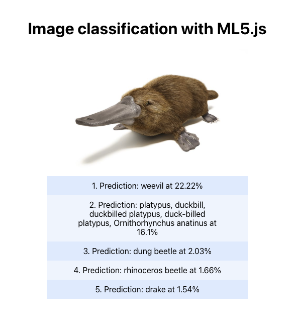

# react-ml5

Image classification with React and ML5.js using MobileNet.



## Setup

```bash
npm install
```

## Development

```bash
npm run dev
```

## Build

```bash
npm run build
npm run preview
```
